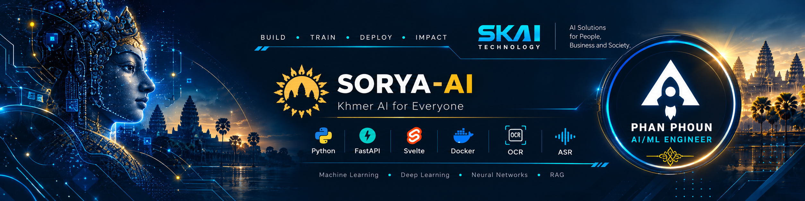

# Hi, I'm Phan Phoun 👋

<div align="center">
  
</div>

### AI/ML Engineer | Full-Stack Developer | Cambodia 🇰🇭

**Building intelligent software and advancing Khmer-language AI.**


<p>
  <a href="https://github.com/phanphounkh">
    
  </a>
  <a href="https://www.linkedin.com/in/phanphoun/">
    
  </a>
  <a href="https://www.camdev.site/">
    
  </a>
</p>

</div>

---

## `phoun@skai:~$ whoami`

```yaml
developer:
  name: Phan Phoun
  role: AI/ML Engineer
  company: SKAI Technology
  location: Cambodia
  os: Debian Linux
  editor: VS Code

  expertise:
    - Artificial Intelligence
    - Machine Learning
    - Deep Learning
    - Natural Language Processing
    - Computer Vision
    - Large Language Models
    - Full-Stack AI Development

  currently:
    building: Sorya-AI
    exploring: Khmer OCR & ASR
    learning: Neural Networks and Transformers
    interested_in: RAG, LLMs, AI Agents

  philosophy: "Learn. Build. Improve."
```

## `phoun@skai:~$ cat about-me.md`

I'm an **AI/ML Engineer at SKAI Technology** passionate about building intelligent applications that solve real-world problems.

My work combines artificial intelligence, backend development, frontend engineering, databases, and deployment.

I'm particularly interested in building AI systems that understand the **Khmer language**, including handwriting recognition, speech recognition, and intelligent document processing.

### 🔭 What I'm working on

- 🤖 Developing AI applications and intelligent assistants
- 🇰🇭 Exploring Khmer OCR and Automatic Speech Recognition
- 🧠 Studying neural networks, backpropagation, and transformers
- 📚 Building RAG pipelines, embeddings, and semantic search
- ⚡ Developing APIs with FastAPI, PostgreSQL, and Redis
- 🐳 Deploying and monitoring services with Docker and Grafana

---

## `phoun@skai:~$ cat tech-stack.yml`

### 💻 Programming Languages


### 🧠 AI & Machine Learning


### ⚡ Backend & Frontend


### 🗄️ Databases & Infrastructure


---

## `phoun@skai:~$ ls projects/`

### ☀️ Sorya-AI — Intelligent AI Assistant

**AI application development at SKAI Technology**

Working on intelligent AI capabilities including document understanding, retrieval-augmented generation, multilingual processing, and scalable AI services.

**Technology stack:**

`Python` `FastAPI` `SvelteKit` `TypeScript` `PostgreSQL` `Redis` `Docker` `LLMs` `RAG`

```text
SORYA-AI
│
├── AI & Language
│   ├── Large Language Models
│   ├── Retrieval-Augmented Generation
│   ├── Embedding & Semantic Search
│   └── Khmer OCR / ASR Exploration
│
├── Backend
│   ├── FastAPI
│   ├── PostgreSQL
│   └── Redis
│
├── Frontend
│   ├── SvelteKit
│   └── TypeScript
│
└── Infrastructure
    ├── Docker
    ├── Prometheus
    └── Grafana
```

### 🇰🇭 Khmer OCR & Speech Recognition

Exploring AI techniques to make Khmer-language content more accessible.

**Areas of focus:**

- Khmer printed-text recognition
- Khmer handwriting recognition
- OCR dataset preparation and labeling
- Text-line detection and segmentation
- Khmer speech recognition
- Computer vision and deep learning

### 💻 Sastra

[](https://github.com/phanphounkh/sastra)

A public development workspace for software experiments and learning.

---

## `phoun@skai:~$ github --stats`

<div align="center">


</div>

### 📈 Contribution Activity

<div align="center">


</div>

---

## `phoun@skai:~$ cat learning-roadmap.md`

| Area | Current Learning Goals |
|:---|:---|
| 🧮 Mathematics | Linear algebra, derivatives, gradients, optimization |
| 🧠 Neural Networks | Forward propagation, backpropagation, gradient descent |
| 🔥 Deep Learning | PyTorch, training loops, model evaluation |
| 🤖 Large Language Models | Tokenization, attention, transformers, fine-tuning |
| 🇰🇭 Khmer AI | OCR, ASR, datasets, model evaluation |
| 🚀 AI Engineering | Inference, monitoring, deployment, scalability |

---

## `phoun@skai:~$ cat connect.md`

<div align="center">

### 🤝 Let's Connect!

**Interested in AI, machine learning, open source, or building useful technology?**

Let's connect and share ideas.

<p>
<a href="https://github.com/phanphounkh">

</a>

<a href="https://www.linkedin.com/in/phanphoun/">

</a>

<a href="https://www.camdev.site/">

</a>
</p>

---

*"The best way to understand intelligence is to build it, test it, and keep learning."*

`while (learning) { build(); experiment(); improve(); }`

**Made with ☕, Python, and curiosity in Cambodia 🇰🇭**

</div>
